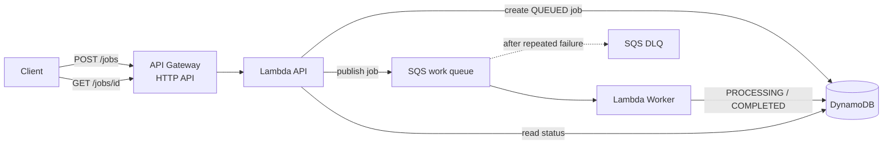

# Serverless MVP Reference

[](https://github.com/krystalit-hq/serverless-mvp-reference/actions/workflows/ci.yml)

A small AWS reference architecture for asynchronous MVP workloads that treats
failure, retries, idempotency and traceability as part of the first design —
not as cleanup work for later.

The goal is not to fit as many AWS services as possible into one diagram.

It is to answer a few questions early:

- What happens when processing fails?
- What happens when the same message is delivered twice?
- How do we trace one request across an asynchronous boundary?
- Where does persistently failed work go?
- What can each component actually access?

> **Production-aware does not mean production-complete.**

## Architecture



The happy path is only half of the architecture. The retry and dead-letter paths
are intentionally visible.

## What has been verified end to end

The reference was deployed to AWS and manually verified before the example
infrastructure was destroyed:

| Scenario | Expected behavior | Result |
| --- | --- | --- |
| Successful job | `QUEUED → PROCESSING → COMPLETED` | Verified |
| Duplicate delivery | Completed job is not processed again | Verified |
| Persistent worker failure | Retry, then redrive to DLQ | Verified |
| HTTP request | `POST /jobs` returns `202 Accepted` | Verified |
| Status lookup | `GET /jobs/{job_id}` returns the completed result | Verified |
| Correlation | Correlation ID crosses HTTP → SQS → worker | Verified |

## Request flow

Create a job:

```http
POST /jobs
Content-Type: application/json
X-Correlation-Id: my-request-123

{
  "hello": "world"
}
```

The API responds immediately:

```json
{
  "job_id": "3d4e0e9c-3ade-4953-9a21-91ba0f3fe21f",
  "status": "QUEUED",
  "correlation_id": "my-request-123"
}
```

The worker processes the message asynchronously.

Query the current state:

```http
GET /jobs/3d4e0e9c-3ade-4953-9a21-91ba0f3fe21f
```

A completed job looks like:

```json
{
  "job_id": "3d4e0e9c-3ade-4953-9a21-91ba0f3fe21f",
  "status": "COMPLETED",
  "correlation_id": "my-request-123",
  "result": {
    "accepted_payload": {
      "hello": "world"
    },
    "processed": true
  }
}
```

## Failure flow

The queue uses a dead-letter queue and an explicit redrive policy.

```text
SQS
 |
 | delivery
 v
Worker
 |
 | failure
 v
message becomes visible again
 |
 | repeated failures
 v
DLQ
```

For a controlled failure test, use:

```json
{
  "force_failure": true
}
```

See `examples/api-job-failure.json`.

## Idempotency

Lambda with SQS is an at-least-once processing model. Duplicate delivery must
therefore be considered normal.

The worker uses a short processing lease stored in DynamoDB:

```text
QUEUED
  |
  v
PROCESSING + lease
  |
  +---- success ----> COMPLETED
  |
  +---- crash ------> lease expires ----> retry may reclaim
```

A completed `job_id` is treated as a harmless duplicate.

This is deliberately stronger than a permanent "seen this ID" marker. A
permanent marker written before the side effect can lose work if the worker
crashes after claiming the job but before completing it.

The example still does **not** claim universal exactly-once behavior. External,
non-transactional side effects may require a stronger domain-specific
idempotency design.

## Partial batch failures

The Lambda event source mapping enables:

```text
ReportBatchItemFailures
```

The worker returns only failed SQS message IDs. One bad message therefore does
not force successfully processed messages from the same batch to be retried.

## Correlation

The API accepts:

```text
X-Correlation-Id
```

If the client does not provide one, the API Gateway request ID is used.

The same ID is carried through:

```text
HTTP request
    ↓
Lambda API
    ↓
SQS message
    ↓
Lambda Worker
    ↓
DynamoDB + structured logs
```

No additional observability platform is required to demonstrate the trace.

## Responsibility boundaries

The API Lambda can:

- create and read job records,
- mark submission failure,
- send messages to the work queue,
- write its own logs.

The worker Lambda can:

- receive and delete work queue messages,
- read/update job records,
- write its own logs.

The roles are separate because the responsibilities are separate.

## Deploy

Requirements:

- Terraform `>= 1.9`
- AWS credentials configured locally
- Python 3
- GNU Make

Initialize:

```bash
make init
```

Package and validate:

```bash
make validate
```

Review:

```bash
make plan
```

Deploy:

```bash
make apply
```

Get the HTTP API endpoint:

```bash
terraform -chdir=infra output -raw api_endpoint
```

### Example request

```bash
curl -i -X POST "$API_URL/jobs" \
  -H "Content-Type: application/json" \
  -H "X-Correlation-Id: example-1" \
  --data-binary "@examples/api-job-success.json"
```

## Destroy

This repository creates real AWS resources.

When finished:

```bash
make destroy-plan
make destroy
```

A reference architecture should be easy to remove as well as easy to create.

## Tests

Install development dependencies:

```bash
python -m pip install -r requirements-dev.txt
```

Run:

```bash
make test
```

The tests cover the application behavior without requiring an AWS account.

## Terraform state

This repository intentionally does not prescribe a remote Terraform backend.

State storage is an ownership, environment and delivery decision. Hard-coding
one backend into a small reference would make that decision look universal when
it is not.

For team or long-lived environments, use an appropriate remote backend and
state locking strategy.

## Known boundary: terminal business failure

SQS knows when a message has exceeded its receive count and moves it to the DLQ.

The application does not automatically receive a "this message has now entered
the DLQ" callback. A job that repeatedly fails may therefore retain an expired
`PROCESSING` state in DynamoDB even though its message is already dead-lettered.

That boundary is intentional in this reference.

Possible production solutions include:

- a separate DLQ consumer that marks the job `FAILED`,
- operational reconciliation,
- a different orchestration model when terminal workflow state is part of the
  domain.

Adding another component only to hide this trade-off would make the reference
less useful.

## Deliberately not included

- authentication / authorization,
- browser-specific CORS configuration,
- Cognito,
- Step Functions,
- EventBridge,
- ECS / EKS,
- Redis,
- RDS,
- WAF,
- a custom observability stack,
- speculative Terraform modules,
- a prescribed remote state backend.

These are not universally bad choices. They are simply not required to explain
the problem this repository exists to explain.

## Repository structure

```text
.
├── .github/workflows/ci.yml
├── docs/
│   ├── architecture.md
│   └── decisions.md
├── examples/
│   ├── api-job-failure.json
│   └── api-job-success.json
├── infra/
├── scripts/
├── src/
│   ├── api/handler.py
│   └── worker/handler.py
├── tests/
│   ├── conftest.py
│   ├── test_api.py
│   └── test_worker.py
├── Makefile
├── requirements-dev.txt
└── README.md
```

## Design notes

The reasoning behind the choices is kept separate from the implementation:

- [`docs/architecture.md`](docs/architecture.md)
- [`docs/decisions.md`](docs/decisions.md)

The architecture is intentionally small enough that the dependency graph can
still be understood without another abstraction layer.

---

Built by [KrystalIT](https://krystalit.pl) — **Spokój w chaosie technologii.**
