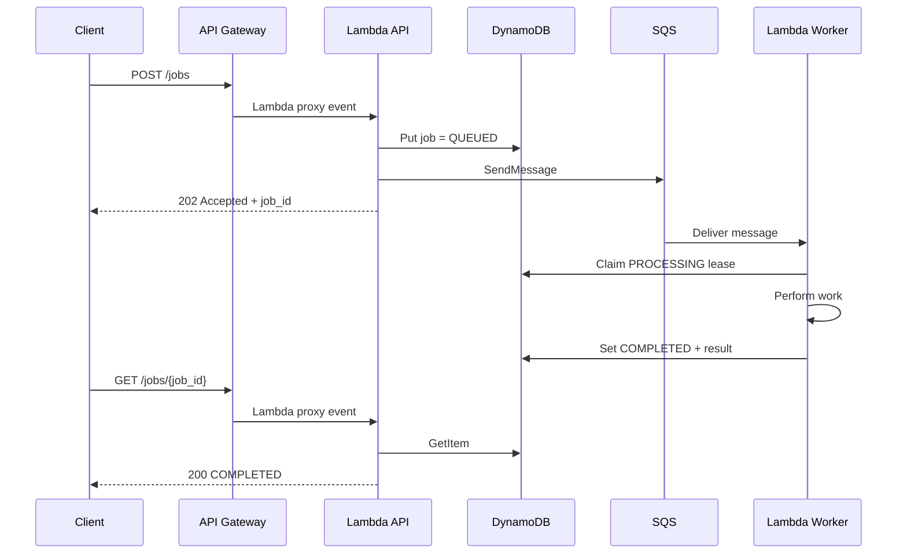
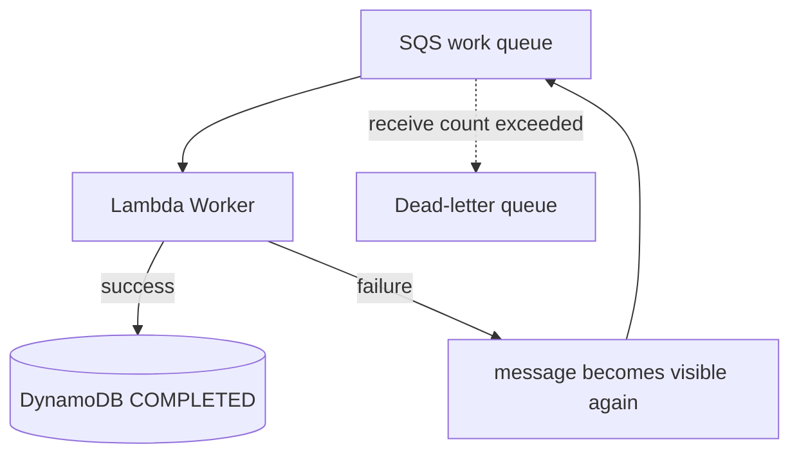

# Architecture

## Purpose

This reference demonstrates a small asynchronous job-processing system on AWS.

It is designed around one constraint:

> The first version should be simple without pretending that failure does not
> exist.

## Components

### API Gateway — HTTP API

Exposes:

```text
POST /jobs
GET  /jobs/{job_id}
```

### Lambda API

Responsibilities:

- validate incoming JSON,
- create a job ID,
- establish a correlation ID,
- write the initial `QUEUED` record,
- send the job to SQS,
- expose job state.

### SQS work queue

Creates the asynchronous boundary between accepting a request and doing the
work.

Configured with long polling, server-side encryption, an explicit visibility
timeout and a dead-letter redrive policy.

### Lambda Worker

Responsibilities:

- parse the SQS message,
- claim a processing lease,
- avoid re-running completed jobs,
- execute work,
- persist the result,
- report individual failed messages.

### DynamoDB

Stores one item per `job_id`.

Typical states:

```text
QUEUED
PROCESSING
COMPLETED
SUBMISSION_FAILED
```

### Dead-letter queue

Receives messages that continue to fail after the configured receive limit.

The DLQ is transport state, not automatically a domain-level `FAILED` state.

## Happy path



## Duplicate delivery

```text
same job_id delivered again
        ↓
worker checks DynamoDB
        ↓
status == COMPLETED
        ↓
duplicate_job_ignored
        ↓
no second side effect
```

## Worker crash / retry

```text
worker claims PROCESSING lease
        ↓
worker crashes
        ↓
message becomes visible again
        ↓
lease eventually expires
        ↓
retry can reclaim the job
```

## Persistent failure



## Submission failure

The API writes `QUEUED` before publishing to SQS so that a returned job ID can
be queried immediately.

There is no distributed transaction between DynamoDB and SQS.

If `SendMessage` fails, the API compensates by changing the item to:

```text
SUBMISSION_FAILED
```

## Traceability

Structured logs include `job_id` and `correlation_id`. The correlation ID
crosses the asynchronous boundary inside the SQS message.

## Security boundary

API role:

```text
SQS:       SendMessage
DynamoDB:  GetItem, PutItem, UpdateItem
Logs:      CreateLogStream, PutLogEvents
```

Worker role:

```text
SQS:       ReceiveMessage, DeleteMessage, GetQueueAttributes
DynamoDB:  GetItem, UpdateItem
Logs:      CreateLogStream, PutLogEvents
```

## What this architecture does not claim

It does not claim:

- universal exactly-once execution,
- production-ready public authentication,
- terminal business failure synchronization with the DLQ,
- a universal Terraform state strategy,
- that DynamoDB is right for every serverless workload.
